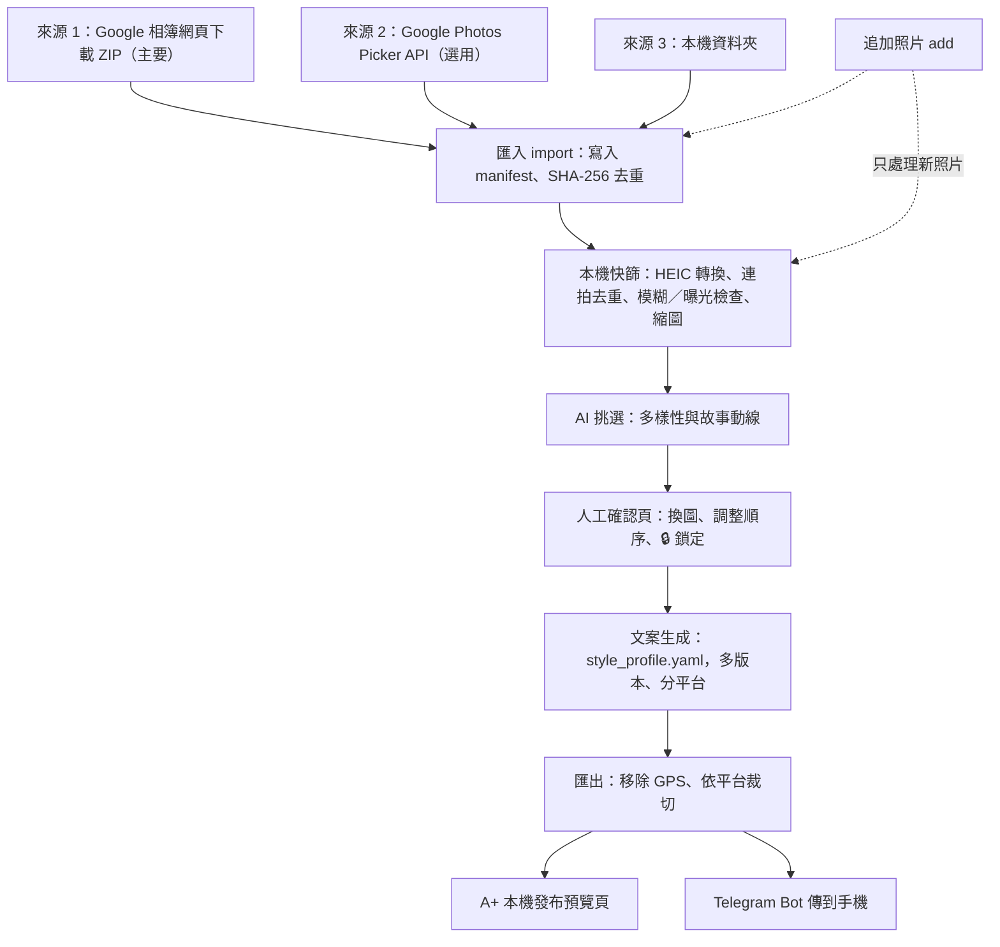
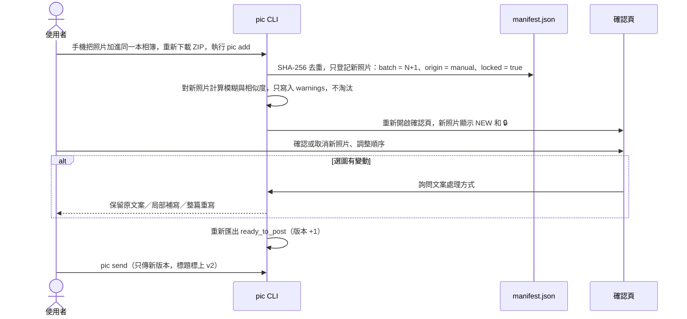

# 旅行照片智慧挑選與個人風格社群發文系統規格（v2）

> 本文件為 Antigravity 的專案藍圖。原始版本保留於 `code_artifact.md`。
>
> **v2 主要變更**
> - 新增「照片來源」：**以手機建立的 Google 相簿 → 網頁下載 ZIP** 為主要來源（保留 GPS、免 OAuth）；Picker API 改為選用
> - 新增 **「手動加入 = 鎖定」** 規則：使用者自己加的照片不經過篩選淘汰，也不會被 AI 換掉
> - 移除「模式 B：Meta Graph API 自動發布」，改為 **A+ 本機預覽頁** 與 **Telegram 傳送到手機**
> - 新增「旅程工作區」與 **追加照片（增量處理）** 流程
> - 新增人工確認關卡、連拍去重、隱私保護、平台尺寸裁切、多版本文案

---

## 0. 設計原則

1. **零／低成本**：快篩全部在本機執行，只有挑選與撰寫文案使用多模態 AI。
2. **不碰社群發文 API**：系統負責準備素材，按下「發布」這一步交給使用者，不必擔心帳號風控。
3. **人保有最後決定權**：AI 只提出建議，挑選和文案都要經過人工確認。
4. **可重跑、可追加**：每趟旅程有自己的工作區和狀態檔（manifest），重跑或追加照片時不會重算已處理過的照片。

---

## 1. 系統架構



---

## 2. 旅程工作區結構

每趟旅程一個資料夾，所有狀態集中在 `manifest.json`。

```
picOrganize/
├── config.yaml                # 全域設定（門檻、張數、平台尺寸）
├── style_profile.yaml         # 個人文風
├── .env                       # 機密：Telegram Token、Chat ID（不可提交至版控）
├── secrets/
│   ├── google_client.json     # Google OAuth 用戶端（不可提交至版控）
│   └── google_token.json      # 授權後產生的 Token（不可提交至版控）
└── trips/
    └── 2026-11-台南/
        ├── manifest.json      # 每張照片的來源、雜湊、分數、狀態
        ├── inbox/             # 手動丟入或 ZIP 解壓縮的暫存區
        ├── raw/               # 匯入後的原圖（檔名 = 拍攝時間_短雜湊）
        ├── thumbs/            # 512px 縮圖（AI 判讀用）
        ├── ready_to_post/     # 匯出成品（已移除 GPS、已裁切）
        │   ├── ig/
        │   └── fb/
        └── captions/
            ├── v1.md
            └── v2.md
```

### `manifest.json` 單筆照片欄位

```json
{
  "id": "20261108_143012_a1b2c3",
  "source": "album_zip",
  "source_file": "PXL_20261108_063012.jpg",
  "batch": 1,
  "taken_at": "2026-11-08T14:30:12+08:00",
  "sha256": "...",
  "phash": "...",
  "burst_group": "g12",
  "cluster": "spot-03",
  "scores": { "blur": 0.82, "exposure": 0.91 },
  "status": "candidate",
  "origin": "auto",
  "locked": false,
  "warnings": [],
  "order": null
}
```

`status` 狀態流轉：`imported` → `rejected`（附原因：`blur`／`duplicate`／`exposure`）或 `candidate` → `selected` → `exported`

| 欄位 | 值 | 說明 |
|---|---|---|
| `origin` | `auto` | 第一次匯入、交給程式篩選和挑選的照片 |
| | `manual` | 使用者自己加入的照片（追加匯入，或在確認頁手動勾選） |
| `locked` | `true` | **鎖定**：不經過淘汰，也不會被 AI 換掉。`origin = manual` 的照片一律為 `true` |
| `warnings` | `["blur", "similar:#05"]` | 鎖定的照片只**顯示提醒**，不淘汰 |

---

## 3. 照片來源

### 3.1 來源 1：手機建立 Google 相簿 → 網頁下載 ZIP（主要）

**使用流程**

1. 旅行時或回家後，在手機的 Google 相簿 App **建立一本相簿**（例如「2026-11 台南」），把這趟的照片加進去。
2. 在電腦開啟 photos.google.com → 進入該相簿 → 右上角 ⋮ →「全部下載」（快捷鍵 `Shift + D`）。
3. 執行 `pic import --trip 2026-11-台南 --zip-watch`。程式監看「下載」資料夾，ZIP 下載完成後就**自動解壓縮到 `inbox/` 並匯入**。也可以直接指定：`pic import --zip <路徑>`。

**優點**

| 比較項目 | 相簿 ZIP | Picker API |
|---|---|---|
| 一次性設定 | **不用設定** | Google Cloud 專案＋OAuth（約 10 分鐘） |
| GPS 位置 | **通常保留**（原始檔） | 會被移除 |
| 授權過期 | 不會 | 測試模式約 7 天要重新登入 |
| 挑照片的地方 | 手機相簿 App（建相簿時就挑好了） | Picker 畫面 |
| 手動步驟 | 電腦端點 2 下下載 | 掃描 QR Code 後勾選 |

**注意事項**
- 相簿很大時，Google 可能會把下載**拆成多個 ZIP**。程式會把同一段時間內下載的 ZIP 都視為同一批匯入。
- iPhone 的原況照片（Live Photo）可能會同時帶有 `.HEIC` 和 `.MOV`。程式預設只匯入靜態照片，影片檔留在 `inbox/_skipped/`。
- **追加照片很簡單**：在手機上把新照片加進**同一本相簿**，再整本重新下載就好。舊照片的 SHA-256 雜湊值相同，程式會自動略過，只處理新照片（見第 9 節）。如果雜湊值剛好不同，再以「原始檔名＋拍攝時間」作為第二道比對。

### 3.2 來源 2：Google Photos Picker API（選用，之後再做）

適合不想建相簿、或想從手機直接勾選後讓電腦自動下載的情境。**第一版先不實作**，等之後有需要再加。

> [!IMPORTANT]
> Google 自 2025 年 3 月起限制 Library API，第三方程式**不能再讀取整個相簿**。現在官方唯一正規的做法是 **Picker API**：由使用者在 Google 相簿介面中自己勾選照片，程式只能拿到被勾選的那些照片。這樣反而更安全。

**一次性設定（約 10 分鐘）**

1. 到 Google Cloud Console 建立專案，啟用 **Google Photos Picker API**。
2. 在「OAuth 同意畫面」選擇外部（External），把自己的 Google 帳號加為**測試使用者**。
3. 建立 OAuth 用戶端 ID，類型選**電腦版應用程式（Desktop app）**，下載 JSON 存為 `secrets/google_client.json`。
4. 授權範圍（Scope）只需要一個：`https://www.googleapis.com/auth/photospicker.mediaitems.readonly`

**使用流程**

1. 執行 `pic import --trip 2026-11-台南 --picker`。
2. 程式建立 Picker 工作階段（session），**同時開啟瀏覽器並在終端機顯示 QR Code**。
   - 在電腦上：直接在瀏覽器裡勾選。
   - 在手機上：掃描 QR Code，在 Google 相簿 App 裡勾選，用手機挑照片最順手。
3. 程式依 `pollingConfig` 建議的間隔輪詢，等到 `mediaItemsSet = true`。
4. 呼叫 `mediaItems.list` 取得清單，用 `baseUrl + "=d"` 加上 Bearer Token 下載原圖（照片）；影片則用 `"=dv"`。
5. 下載完成後刪除 session。

**限制與注意事項**

| 項目 | 說明 | 系統對策 |
|---|---|---|
| `baseUrl` 效期約 60 分鐘 | 超過就失效 | 勾選完成後立即下載，下載時平行處理並在失敗時重試 |
| **`=d` 下載的檔案會移除 GPS 位置** | EXIF 的時間和相機資訊會保留，但座標會被拿掉 | 改用時間分群；地點名稱改由「人工確認頁」輸入，或交給 AI 從畫面辨識；真的需要 GPS 時改用來源 1 |
| 測試模式的 Refresh Token 約 7 天到期 | 未發布的 OAuth App 限制 | 到期時自動開啟瀏覽器重新登入（一次點擊） |
| 只能拿到使用者勾選的照片 | API 的設計就是如此 | 教學：在 Google 相簿先以日期範圍或相簿篩選，再一次全選 |

### 3.3 來源 3：本機資料夾

直接把照片放進 `trips/<旅程>/inbox/`，再執行 `pic import --trip <旅程>`。

---

## 4. 本機快篩（不耗費任何外部 API 額度）

依下列順序執行，**只處理 manifest 裡狀態為 `imported` 的照片**（支援增量處理）：

1. **格式統一**：用 `pillow-heif` 支援 HEIC。原圖保持不動，只在記憶體中轉換。
2. **完全重複**：SHA-256 相同的照片直接略過，同一張照片重複匯入也不怕。
3. **連拍／相似照分組**：用 `imagehash` 計算 pHash，漢明距離 ≤ `config.dedupe.phash_distance`（預設 6）且拍攝時間差 ≤ 10 秒的照片歸為同一組 `burst_group`，每組只保留品質分數最高的一張。
4. **時間分群**：照片之間的時間差超過 `config.cluster.gap_minutes`（預設 40）就切分成下一個景點區塊。有 GPS 時，再用 `reverse_geocoder` 離線反查地名。
5. **模糊檢測**：先縮放到長邊 1024px，再計算 Laplacian 方差，**在同一景點群組內排名**，淘汰後 `config.blur.drop_ratio`（預設 25%）。不寫死門檻值，避免淺景深的照片被誤殺。
6. **曝光檢查**：檢查直方圖兩端的比例，嚴重過曝或過暗的照片標記為 `exposure`。
7. **縮圖**：長邊 512px，存到 `thumbs/`。
8. **快取**：分數寫回 manifest，重跑時不重新計算。

> [!IMPORTANT]
> **鎖定的照片（`locked: true`）一律不淘汰**：快篩照常計算分數，但只寫入 `warnings` 作為提醒（例如「略模糊」「與 #05 相似」），照片本身維持選取。
> 唯一的例外是第 2 步的**完全重複**（同一個檔案匯入兩次）：這種情況不會產生第二筆紀錄，原本的鎖定狀態也不受影響。

---

## 5. AI 挑選與人工確認

### 5.1 AI 挑選（Antigravity Agent）
- 輸入：候選照片的縮圖、所屬景點群組、拍攝時間。
- 依故事動線挑出 `config.select.count` 張（預設 8 張，IG 輪播最多 20 張），兼顧全景、特寫、美食、合照。
- **鎖定的照片是固定名額**：AI 只能從剩下的名額補選，不能把鎖定的照片換掉；排列順序時也要把鎖定的照片放進故事動線。
- 鎖定照片的張數超過 `select.count` 時，**不會刪掉任何一張**，而是自動擴充張數（上限 20 張），並在確認頁提醒。
- 輸出：每張照片的挑選理由，以及建議的輪播順序，寫回 manifest。

### 5.2 人工確認頁（`pic review`，本機網頁）
- 照片牆依景點分組，AI 挑選的照片會加上外框並顯示理由；鎖定的照片顯示 🔒。
- 操作：點擊切換選取／取消、拖曳調整順序、替景點輸入地名或備註（提供給文案使用）。
- **你在這頁勾選的照片自動變成 `origin: manual`＋🔒 鎖定**；再點一次取消勾選，才會解除鎖定。
- **「已淘汰」區塊**（預設收合）：列出被篩掉的照片和原因（模糊、相似、曝光），點一下就能**救回來並鎖定**。
- 鎖定照片上的 ⚠️ 提醒（略模糊、與某張相似）只是告訴你這件事，不影響選取。
- 追加照片後，新照片會顯示 **「NEW」** 標籤，並提供「只看新照片」篩選。
- 按下「確認選圖」後才進入文案生成。

---

## 6. 文案生成

- 讀取 `style_profile.yaml`（格式與 v1 相同），加入以下輸入：選中照片的畫面細節、景點備註、地名。
- **一次產出 2～3 個版本**（例如：短版、敘事版、幽默版）。
- **依平台調整**：

| 平台 | 長度 | Hashtag | 風格 |
|---|---|---|---|
| FB | 中長 | 0～3 個 | 敘事、分段留白 |
| IG | 中 | 4～8 個，放在文末 | 第一句要能吸引目光 |
| Threads | 短（500 字以內） | 0～1 個 | 口語、碎念感 |

- **風格回饋迴圈**：使用者在發布頁修改後的「最終版」可以一鍵存回 `style_profile.yaml` 的 `few_shot_examples`（保留最近 N 篇），讓風格越用越準。

---

## 7. 匯出

- **移除所有 GPS 與裝置序號 EXIF**（保留拍攝時間）。
- **依平台裁切**：IG 4:5（1080×1350）；FB 保留原比例，長邊 2048px。裁切框預設置中，可在確認頁調整。
- 檔名依輪播順序加上編號：`01_20261108_1430.jpg`、`02_...`。**順序一改就重新編號**，只是改檔名，不重新運算，所以是即時的。
- 選用：`config.export.sequential_time: true`，把匯出檔的拍攝時間改成依順序每張間隔 1 秒，讓手機相簿依時間排序時也會照你的順序排。預設關閉，因為會改掉真實的拍攝時間（原圖不會被修改）。

---

## 8. 發布

> [!NOTE]
> 系統不串接社群 API，所以**沒有一鍵送出貼文**。系統負責「順序排好、文案備好」，你在 FB／IG 按下發布。

### 8.1 A+：本機發布預覽頁（`pic publish`）
- 依平台分頁（FB／IG／Threads），每頁上方用**仿貼文的輪播預覽**顯示照片，每張照片左上角標示順序編號 ①②③。
- **拖曳排序**：直接拖曳縮圖調整順序（使用 `SortableJS`，滑鼠和觸控都支援）。放開後馬上存回 manifest，`ready_to_post/` 的檔名也同步重新編號。
  - 預設**各平台共用同一個順序**；勾選「此平台獨立排序」後，可以替 IG 另外排一組（例如 IG 第一張放比較吸睛的照片）。
  - 「↺ 恢復 AI 建議順序」按鈕。
  - 第一張照片標示「封面」，IG 分頁會用 4:5 比例顯示裁切後的效果。
- 文案可以直接編輯，旁邊有「📋 複製文案」按鈕。
- 「📂 開啟資料夾」按鈕：開啟對應平台的 `ready_to_post/` 子資料夾，視窗預設依檔名排序。
- 「⭐ 存為風格範例」按鈕：觸發 6. 的風格回饋迴圈。

**上傳時讓順序正確的操作方式**（顯示在預覽頁的提示框中）

| 方式 | 順序 | 建議 |
|---|---|---|
| 在 FB／IG 按「新增相片」，從檔案對話框中**先點 `01`，再按住 Shift 點最後一張** | 通常依檔名排序 | ⭐ 推薦 |
| 從檔案總管 Ctrl+A 全選後拖曳 | Windows 不保證拖曳順序，可能會亂 | 不推薦 |
| 上傳後在 FB／IG 的編輯畫面拖曳調整 | 兩個平台都支援 | 順序亂掉時的補救方式 |

上傳後對照預覽頁上的編號縮圖，就能很快確認順序是否正確。

### 8.2 Telegram Bot 傳到手機（`pic send`）

**設定**
1. 在 Telegram 找 `@BotFather` 傳送 `/newbot`，建立**專用的新 Bot**（例如 `xxx_photo_bot`），取得 Token。
2. 對新 Bot 傳送 `/start`，執行 `pic telegram-setup` 自動取得 `chat_id`。
3. 把設定寫入 `.env`：`TELEGRAM_BOT_TOKEN=...`、`TELEGRAM_CHAT_ID=...`

**傳送內容（每個平台一組）**
1. 文字訊息：`【IG｜v2｜2026-11-台南】`，接著是**純文字文案**。文案獨立成一則訊息，因為一般訊息上限 4096 字，媒體說明欄只有 1024 字；獨立一則也方便長按複製。
2. 照片相簿：用 `sendMediaGroup` **依預覽頁排好的順序**傳送，每組 2～10 張，超過時自動分組（第 1～10 張、第 11～20 張）。
   - 預設以 **document（檔案）** 傳送，保留原始畫質，避免 Telegram 壓縮；檔名帶有順序編號。
   - `config.telegram.mode: photo` 可改為一般照片模式（預覽較快，但會被壓縮）。
3. 在預覽頁改了順序之後，可以按「📤 重新傳到 Telegram」。

**手機端操作**：在 Telegram 長按複製文案 → 存下照片 → 開啟 IG／FB，**依編號順序逐張點選**。IG 和 FB App 都會依點選的先後順序排列。

---

## 9. 追加照片流程



**規則**
- **第一次匯入（`pic import`）＝交給程式**：`origin: auto`，經過完整的快篩和 AI 挑選。
- **之後追加（`pic add`）＝你指定的**：預設 `origin: manual`＋🔒 鎖定，**不經過淘汰，也不會被 AI 換掉**，模糊或相似的照片都會保留下來。
  - 新照片和既有照片很相似時，只顯示 ⚠️「與 #05 相似」提醒，**兩張都保留**，由你決定要不要取消其中一張。
  - 如果這批追加的照片想交給程式挑，改用 `pic add --auto`：照片進入候選池，照常篩選。
- **在確認頁手動勾選或救回的照片**，也一律變成鎖定。
- 追加照片後**不重新執行 AI 挑選**，只請 AI 調整輪播順序，把新照片排進故事動線；原本選好的照片維持不變。
- 文案的「局部補寫」會把舊文案當作基礎，只針對新照片補一兩句，盡量保留你已經修改過的內容。
- 已匯出的舊版本保留在 `ready_to_post/` 的歷史子資料夾，可以隨時回溯。

---

## 10. CLI 指令總覽

| 指令 | 說明 |
|---|---|
| `pic new <旅程>` | 建立旅程工作區 |
| `pic import --trip <旅程> [--zip <路徑> \| --zip-watch]` | 第一次匯入並執行快篩（交給程式挑選） |
| `pic add --trip <旅程> [--zip <路徑> \| --zip-watch] [--auto]` | 追加照片：預設鎖定、不淘汰；加上 `--auto` 則交給程式篩選 |
| `pic lock / unlock --trip <旅程> <照片 id...>` | 用指令鎖定或解除鎖定（效果和確認頁相同） |
| `pic select --trip <旅程>` | 產生供 Antigravity 判讀的候選清單和縮圖 |
| `pic review --trip <旅程>` | 開啟人工確認頁 |
| `pic write --trip <旅程> [--mode keep\|patch\|rewrite]` | 生成或更新文案 |
| `pic export --trip <旅程>` | 移除 GPS、裁切、輸出成品 |
| `pic publish --trip <旅程>` | 開啟 A+ 發布預覽頁 |
| `pic send --trip <旅程> [--platform ig\|fb\|threads]` | 傳送到 Telegram |
| `pic telegram-setup` | 取得 chat_id 並寫入 `.env` |

---

## 11. 技術選型

- 環境：**uv + `.venv`**（不使用全域 pip）
- 影像：`Pillow`、`pillow-heif`、`opencv-python-headless`、`imagehash`、`piexif`
- 地理：`reverse_geocoder`（離線）
- 檔案監看：`watchdog`（偵測「下載」資料夾的 ZIP）
- Google（選用，Picker API）：`google-auth-oauthlib`、`requests`
- 介面：`FastAPI` + 單頁 HTML（確認頁和發布頁共用）、`SortableJS`（拖曳排序）、`qrcode`
- Telegram：直接用 `requests` 呼叫 Bot API（不需要額外的 SDK）
- CLI：`typer`
- 設定：`pydantic-settings`（讀取 `.env`）、`PyYAML`

---

## 12. 給 Antigravity 的啟動指令（v2）

```markdown
請處理旅程 `2026-11-台南`：
1. 執行 `uv run pic import --trip 2026-11-台南 --zip-watch`，等我從 Google 相簿下載整本相簿的 ZIP。
2. 執行 `uv run pic select`，檢視 `thumbs/` 縮圖，依故事動線挑 8 張（鎖定的照片不能換掉），並把理由寫回 manifest。
3. 執行 `uv run pic review` 開啟確認頁，等我確認選圖。
4. 讀取 `style_profile.yaml`，為 FB／IG／Threads 各寫 2 個版本，存到 `captions/`。
5. 執行 `uv run pic export`，再執行 `uv run pic publish` 和 `uv run pic send --platform ig`。
```
